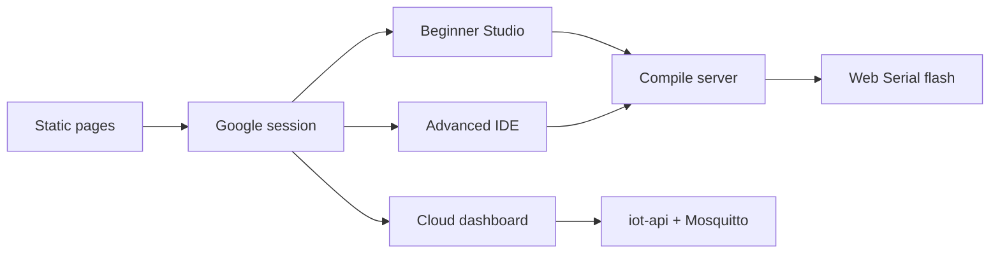
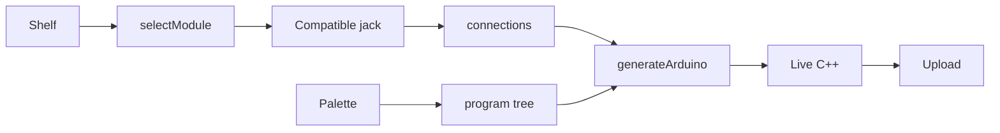
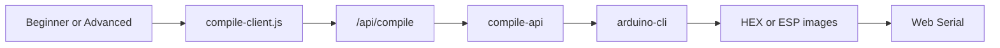
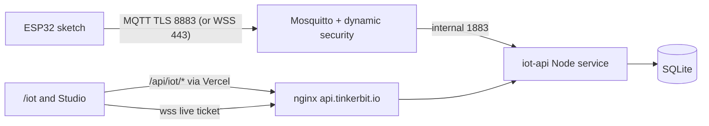

# TinkerBit — project documentation

**Product:** browser studio for the Maker ESP32 RJ11 kit  
**Modes:** Beginner (`/beginner`) and Advanced (`/ide`)  
**Audience:** students, teachers, and anyone who needs to see how the app is put together

This is the project document. It is written as five parts:

1. What TinkerBit is and what it includes  
2. How a person uses Beginner and Advanced  
3. The physical kit: modules, jacks, and the rules the software enforces  
4. How the software is built: pages, login, codegen, compile, and flash  
5. What can go wrong, how the app handles it, and where the code lives  

---

## 1. Product overview and features

TinkerBit is a web application for a physical electronics kit. The board is a Maker ESP32 with RJ11 jacks. Students plug sensors and actuators into those jacks, then program the board in a browser. They do not install the Arduino IDE, and they do not type C++ unless they want to read what the app generated.

The same kit is used in two products:

| Mode | URL | Who it is for | How you program |
|------|-----|---------------|-----------------|
| **Beginner Studio** | `/beginner` | First lessons, classrooms, kit tours | Pick a module, plug it into a jack, click action blocks. Live C++ appears on the side. |
| **Advanced IDE** | `/ide` | Students who already know blocks | OpenBlock Blockly. Generic pin blocks, kit device blocks, motors, I2C, and Blynk. |

Both modes compile the sketch on a server and flash the board from the browser over USB (Web Serial). Chrome or Edge on a computer is required. A phone or Firefox cannot open the USB port.

There is no student project database in this repository. Work lives in the browser session. Beginner templates load a ready-made wiring and program. Advanced projects use the IDE’s own save path.

### 1.1 What the product includes

**Accounts**

- Google sign-in before Choose, Beginner, or Advanced.  
- A **Choose** page: Beginner or Advanced. You can go back and switch.  
- Localhost can open Choose without a session so developers can work offline.

**Beginner Studio**

- A drawing of the Maker ESP32 with labeled jacks (ST, D13, 3D, D5, MD, I2C, A1–A4, ESP, UART).  
- A shelf of kit modules. Click a module, then click a jack that accepts it. Illegal jacks stay blocked and show a short hint.  
- SVG cables from jack to module card. Cards can be dragged; the cable midpoint can bend. Moving a card does not change the GPIO in the sketch.  
- A project library and a quick-start strip. Opening a project lands on **Build**, not Code, so the student sees the wiring first.  
- A Code view: wait, repeat, if/else, print text, print a variable, plus one action per wired module (LED on/off/blink/brightness, read soil, print climate, and so on).  
- A live C++ panel that updates whenever wiring or blocks change. That text is what Upload sends.  
- **Connect board**, **Upload**, and a serial monitor at **9600** (the same baud as `Serial.begin` in the generated sketch).  
- A status bar that prints the jack map so a teacher can check a cable without opening this document.

**Advanced IDE**

- The OpenBlock / Scratch-style workspace: toolbox, canvas, hardware header, serial console.  
- Maker ESP32 categories that were already there: digital write/read, analog read, L293D motors, stepper, I2C begin, Blynk.  
- Maker Kit categories that match Beginner: sensors, outputs, radio (onboard BLE and HC-05).  
- The same compile-and-flash path as Beginner when the Maker ESP32 board is selected.

**Upload and hardware**

- Compile on a server (`arduino-cli`). The browser only receives firmware and writes it over USB.  
- ESP32 download mode: classic auto-reset, slower laptop timing, USB-JTAG reset, then “hold BOOT”.  
- Arduino Uno can be flashed from Advanced when that board is selected.  
- Kit sketches print at 9600. Blynk sketches print at 115200. The serial console must match.

### 1.2 What the product does not do

- It does not replace the Arduino IDE for arbitrary sketches you type yourself (Advanced can, but the compile server only allows three board types).  
- It does not store class rosters or cloud projects in this repo.  
- It does not run on Safari, Firefox, or a phone for upload.  
- It does not ship sensor libraries to the browser. Servo, OLED, RFID, and pulse libraries must already be on the compile server.

---

## 2. User point of view

This section is the path a student or teacher actually takes.

### 2.1 First visit

1. Open the site.  
2. Sign in with Google.  
3. On **How do you want to code?**, pick **Beginner** or **Advanced**.

Beginner is the kit lesson: wire, click blocks, read C++, upload. Advanced is the full block IDE: more control, Blynk, and generic pins.

### 2.2 Beginner — a typical lesson

**Build is the home screen.** After you pick a template, you still land on Build.

**Wire**

1. Click a module in the shelf, for example **LED**.  
2. Legal jacks highlight. For an LED the first choice is **D13** (GPIO 33). A1, A2, A3 also work. D5 does not — that jack is reserved for the ultrasonic sensor.  
3. Click the jack. A card and a cable appear.  
4. Add the rest of the lesson the same way. Some modules have only one jack:

   - HC-SR04 → **D5** only (Trig GPIO 26, Echo GPIO 25).  
   - RFID → **3D** only. Do not use D13 at the same time; they share GPIO 33.  
   - L293D or 4-channel relay → **MD**.  
   - Stepper → **ST**.  
   - OLED and HW-605 → **I2C** (they share the bus).  
   - Onboard BLE → no cable; it attaches to **ESP**.  
   - HC-05 → **UART** (RX GPIO 3, TX GPIO 1 — the same UART as USB).

5. If a jack is wrong, the app shows a short reason instead of connecting.

**Program**

6. Open **Code**. The palette lists control blocks and the actions of whatever you wired.  
7. Click **On / Off**, **Brightness**, **Blink**, **Read distance**, **Print soil moisture**, and so on.  
8. LED brightness is 0–255 PWM on the same pin as On/Off.  
9. Use **If…then** to compare a sensor (soil below 40, distance under 20 cm, button pressed).  
10. Watch the C++ panel. You do not edit it for a normal lesson.

**Upload and see output**

11. Use **Chrome or Edge** on a computer. Use a data USB cable.  
12. Close Arduino IDE Serial Monitor, PuTTY, or another TinkerBit tab. Only one program can own the COM port.  
13. Click **Connect board** and pick the ESP32 in the browser list.  
14. Click **Upload**. Compile runs on the server (can take up to a few minutes the first time). Then the browser flashes the chip.  
15. When it finishes, start the serial monitor. You should see `TinkerBit Beginner ready` and a line for each action (`LED: ON`, `HC-SR04 cm=42`, `Soil moisture=61 %`).

**If upload sticks at about 5%**

The sketch already compiled. The board has not entered download mode. On many laptops the USB chip does not pulse DTR/RTS correctly.

- Hold **BOOT** on the board until progress moves past ~12%, then release.  
- Prefer a USB 2.0 port or a different cable.  
- Unplug, wait two seconds, plug in, Connect again, then Upload while holding BOOT.

**If the serial window is empty or looks like noise**

- Kit sketches use **9600**. The Beginner monitor is fixed at 9600.  
- In Advanced, Blynk sketches use **115200**. Set the hardware console to match the sketch you actually flashed.  
- After upload, press Start on the monitor again. Flash closes the port.

### 2.3 Advanced — a typical session

1. Open `/ide` and select the Maker ESP32 board.  
2. Drag blocks from **Maker Kit Sensors**, **Maker Kit Outputs**, or **Maker Kit Radio**, or from Digital / Analog / Motors / Stepper / I2C / Blynk.  
3. On kit blocks, pick the jack (D13, A1, …). Labels match Beginner. A4 is shown as **A4 (BOOT)**.  
4. Connect and Upload the same way as Beginner.  
5. Open the hardware console at 9600 for kit sketches.

### 2.4 Classroom checklist

- Browser: Chrome or Edge, desktop, HTTPS or localhost.  
- Driver: if Windows does not show a COM port, install CH340 or CP210x for your USB chip. TinkerBit does not ship that driver.  
- One serial owner: close the Arduino IDE monitor before Connect.  
- Cable: data cable, not charge-only.  
- Jacks: follow the table in section 3. Wrong jack is the most common hardware fail (DHT on D13, RFID plus LED on D13, ultrasonic on a single digital pin).

---

## 3. Kit catalog, jacks, and software rules

Beginner only offers modules that exist in the physical kit. Advanced kit blocks use the same GPIO map.

### 3.1 Jack map

| Jack | GPIOs | What it is for |
|------|-------|----------------|
| ST | 12, 13, 14, 27 | 4-wire stepper |
| D13 | 33 | Button, LED, 1-ch relay, servo (not DHT if you can avoid it) |
| 3D | 32 SS, 33 RST, 34 MISO; SPI SCK 16, MOSI 23 | RFID RC522. Conflicts with D13. |
| D5 | Echo 25, Trig 26 | HC-SR04 only. Echo must stay INPUT. |
| MD | 17, 5, 18, 19 | L293D motor A/B or 4-ch relay (active-low) |
| I2C | SDA 21, SCL 22 | OLED and/or HW-605 |
| A1 | 4 | Analog sensors; preferred DHT pin |
| A2 | 15 | Analog (strapping pin) |
| A3 | 2 | Analog (strapping pin) |
| A4 | 0 | Analog / BOOT. Do not hold LOW at reset. |
| ESP | — | Onboard BLE |
| UART | RX 3, TX 1 | HC-05; shared with USB serial at 9600 |

### 3.2 Modules and what the student can do

| Module | Typical jack | Actions in Beginner |
|--------|--------------|---------------------|
| Push button | D13 | Is pressed? (INPUT_PULLUP) |
| Potentiometer | A1–A4 | Read knob 0–4095 (averaged) |
| LED | D13 | On/Off, Brightness 0–255 PWM, Blink |
| Relay (1 ch) | D13 | On/Off |
| Servo | D13 | Set angle (ESP32Servo) |
| L293D | MD | Motor A/B speed and direction, stop |
| 4-ch relay | MD | Channel on/off, all off (active-low) |
| Stepper | ST | Move steps at an RPM |
| OLED | I2C | Show text, show number |
| MQ-2 | A1–A4 | Read / print raw gas (heater needs ~1 min; not ppm) |
| Microphone | A1–A4 | Read loudness |
| HW-605 pulse | I2C | Read BPM (MAX30102 @ 100 kHz) |
| Capacitive soil | A1–A4 | Moisture 0–100% |
| DHT11 | A1 | Temp, humidity, print climate (sample every 2 s) |
| HC-SR04 | D5 | Distance cm (invalid echo → −1) |
| RFID RC522 | 3D | Read UID |
| BLE (onboard) | ESP | Advertise name, send text |
| HC-05 | UART | Send line, read line |

Control blocks (no jack): Wait, Repeat, If…then, Print text, Print variable.

### 3.3 Rules the software enforces

These are the reasons a jack stays grey, or a sketch comment appears.

| Rule | Why it exists | What the app does |
|------|---------------|-------------------|
| D13 and 3D cannot be used together | Both use GPIO 33 (D13 signal and RFID RST) | The second jack is blocked. Hint: unplug the other first. |
| D5 is ultrasonic only | Dual pins; driving Echo as an output heats the module | Digital modules cannot take D5. Code keeps Echo as INPUT. |
| A4 is BOOT (GPIO 0) | LOW at reset enters download mode | Dropdown says **A4 (BOOT)**. Code comments warn before `pinMode`. |
| DHT prefers A1 | GPIO 33 is a poor DHT data pin on this ESP32 | Auto-assign tries A1, A2, A3, then D13. Fail text says plug into A1. |
| RFID SPI is not on D5 | Ultrasonic already owns 25/26 | SCK=16, MOSI=23; SS/RST/MISO on 3D. |
| UART is USB serial | HC-05 RX/TX are U0RXD/U0TXD | Send/receive use `Serial` at 9600. Do not open a second monitor. |
| I2C is shared | OLED and HW-605 are both 3.3 V I2C | Both may use the I2C jack. Pulse init uses 100 kHz, not 400 kHz. |
| Soil is capacitive | Dry ≈ high ADC, wet ≈ low | Map raw ~3200→0%, ~1200→100%. Raw ≈ 0 is a cable fail. |
| MQ-2 / mic / pot noise | Single ADC reads swing | Average 12–16 samples with a short delay. |
| Analog is ADC2 | WiFi/BLE steal ADC2 | Comments: turn the radio off for stable reads. |
| 4-ch relay is active-low | Floating LOW turns channels on at power-up | Setup writes HIGH to 17/5/18/19 (off). ON drives LOW. |
| A2, A3, ST are strapping pins | Wrong level at reset can change boot | Jacks are flagged; A4 is the strongest warning. |

LED default pin is **D13 = GPIO 33**. Brightness uses `analogWrite` on that same pin.

---

## 4. Technical capability

The running system has four layers, plus the optional TinkerBit Cloud service (section 4.6). Cloud has its own SQLite database; nothing else stores application data.

### 4.1 Pages and hosting

Webpack writes several HTML apps into `build/` ([webpack.config.js](webpack.config.js)). [vercel.json](vercel.json) maps clean URLs onto those files and sets security headers (no iframe, no sniff).

| URL | Built as | Purpose |
|-----|----------|---------|
| `/` | landing | Marketing |
| `/login` | login | Google sign-in |
| `/choose` | choose | Beginner vs Advanced |
| `/beginner` | beginnerStudio | Kit studio |
| `/ide` | IDE bundle | OpenBlock GUI |
| `/iot`, `/iot/*` | iot | TinkerBit Cloud dashboard (phone friendly) |

Local development is usually `http://127.0.0.1:8601`.

[middleware.js](middleware.js) runs on `/choose`, `/beginner`, `/ide`, and `/iot`. If auth is on and the session cookie is missing, the request goes to `/login?next=...`. If auth is off, the pages open. If auth is on but `AUTH_SECRET` or `GOOGLE_CLIENT_ID` is missing, login fails closed.

`/api/compile` and `/api/compile/health` are not implemented in the frontend host. They are rewritten to the compile server. `/devices/*` and `/extensions/*` for the Advanced IDE are rewritten the same way.

### 4.2 Sign-in

| Step | File |
|------|------|
| Redirect to Google | [api/auth/google.mjs](api/auth/google.mjs) |
| Exchange code, set cookie | [api/auth/callback.mjs](api/auth/callback.mjs) |
| Who is signed in | [api/auth/me.mjs](api/auth/me.mjs) |
| Clear cookie | [api/auth/logout.mjs](api/auth/logout.mjs) |

[lib/auth/session.mjs](lib/auth/session.mjs) signs the session. After login, `next` may only be `/choose`, `/beginner`, `/ide`, or `/iot`. The choose page calls [src/lib/auth-client.js](src/lib/auth-client.js). On localhost it allows the page through without a session.

### 4.3 Beginner Studio internals

[src/beginner-studio/App.jsx](src/beginner-studio/App.jsx) is a shell: top bar (Build / Code), quick start, the active view, status bar, project library.

State lives in [src/beginner-studio/context/StudioContext.jsx](src/beginner-studio/context/StudioContext.jsx):

- `connections` — `{ id, moduleId, portId, pin, offsetX, offsetY, bendX, bendY }`  
- `program` — nested block tree (`children`, `elseChildren`)  
- `selectedModule` — module waiting for a jack click  
- `view` — `'build'` on first load and after a template load  
- theme, project name, palette filters  

[src/beginner-studio/hooks/useStudioActions.js](src/beginner-studio/hooks/useStudioActions.js) is the only place that mutates that state. Wiring is **select then click**, not drag-onto-a-port. BLE calls `connect` on `ONBOARD` immediately.

| File | Role |
|------|------|
| [modules.js](src/beginner-studio/domain/modules.js) | Catalog, actions, includes |
| [ports.js](src/beginner-studio/domain/ports.js) | Jacks, GPIO, conflicts, `pickPortForModule` |
| [tree.js](src/beginner-studio/domain/tree.js) | Append, nest, delete blocks |
| [codegen.js](src/beginner-studio/domain/codegen.js) | Full sketch: includes, setup, loop, helpers |
| [templates.js](src/beginner-studio/domain/templates.js) | Named projects → connections + program |
| [useGeneratedCode.js](src/beginner-studio/hooks/useGeneratedCode.js) | Memoized C++ |
| [BoardCanvas.jsx](src/beginner-studio/components/build/BoardCanvas.jsx) | SVG board, ports, cables |
| [useBoardUpload.js](src/beginner-studio/hooks/useBoardUpload.js) | Connect / Upload (`arduinoEsp32`) |
| [useSerialMonitor.js](src/beginner-studio/hooks/useSerialMonitor.js) | Monitor at 9600 |

Every generated sketch starts with `Serial.begin(9600)`, a short delay, and `TinkerBit Beginner ready`. Setup then configures only the modules that are actually wired. Loop is the program tree. Helpers (DHT bit-bang, `readAnalogAvg`, `soilRawToPercent`, `getDistanceTrigEcho`, RFID, BLE) are included only when needed.

### 4.4 Advanced IDE internals

The IDE shell is [src/containers/gui.jsx](src/containers/gui.jsx) (OpenBlock VM + Blockly). Maker ESP32 is a static extension:

| File | Role |
|------|------|
| [pin-map.js](static/extensions/makerEsp32/pin-map.js) | Same GPIO numbers as Beginner |
| [blocks.js](static/extensions/makerEsp32/blocks.js) | Block shapes |
| [toolbox.js](static/extensions/makerEsp32/toolbox.js) | Digital, Analog, Motors, Stepper, I2C, Kit Sensors, Kit Outputs, Kit Radio, Blynk |
| [generator.js](static/extensions/makerEsp32/generator.js) | C++ per block; kit helpers copied from Beginner |
| [translations.js](static/extensions/makerEsp32/translations.js) | Labels |

Kit blocks force `Serial.begin(9600)`. Blynk blocks force `Serial.begin(115200)`. If both appear in one workspace, the last `Serial.begin` the generator writes wins. Match the console to that sketch.

### 4.5 Compile and flash

**Browser.** [src/lib/web-serial/compile-client.js](src/lib/web-serial/compile-client.js) POSTs `{ source, fqbn }` (3 minute timeout) and checks `/api/compile/health`.

[src/lib/web-serial/device-profiles.js](src/lib/web-serial/device-profiles.js):

| Board | FQBN | Flash | Monitor | Open for flash |
|-------|------|-------|---------|----------------|
| Uno | `arduino:avr:uno` | STK500 | 9600 | 115200 |
| Maker ESP32 | `esp32:esp32:esp32` | esptool | 9600 | 115200 |
| ESP32-S3 | `esp32:esp32:esp32s3` | esptool | 9600 | 115200 |

[src/lib/web-serial/upload-pipeline.js](src/lib/web-serial/upload-pipeline.js): refuse a second upload, compile, stop the monitor, close the port, flash, close again, notify the monitor.

ESP32 boot ([esptool-flash.js](src/lib/web-serial/esptool-flash.js)), in order:

1. Classic DTR/RTS reset  
2. Slower reset (laptop USB timing)  
3. USB-JTAG reset  
4. Manual BOOT (log: hold the button; 60 s timeout)

Flash baud stays **115200**. Faster rates fail on common CP210x chips. Progress near 5% is bootloader connect, not compile.

[web-serial-port.js](src/lib/web-serial/web-serial-port.js) retries `open()` after a delay (Windows often fails if reopen is instant). [errors.js](src/lib/web-serial/errors.js) maps “port busy”, “insecure origin”, and “failed to connect” into short sentences.

**Server.** [services/compile-api/server.js](services/compile-api/server.js) listens on localhost. `GET /health` → `{ ok: true }`. `POST /api/compile` accepts only the three FQBNs and a sketch up to 128 KB. It writes a temp sketch, runs `arduino-cli`, deletes the folder. Uno → HEX. ESP32 → flash images plus a cleared OTA-data region so the new app boots. Blynk headers add the Blynk library path if that folder exists on the machine. Sensor libraries (ESP32Servo, SSD1306, MFRC522, MAX3010x) must already be installed there.

> **Transport.** Vercel rewrites `/api/compile` to `https://api.tinkerbit.io/api/compile`, so sketches (Cloud sketches carry the WiFi password and device key) are encrypted all the way to the EC2 host. `/devices/*` and `/extensions/*` are public static files and still go to `http://13.127.144.30`.

### 4.6 TinkerBit Cloud (IoT)

Students add the onboard **TinkerBit Cloud** part in Beginner Studio. The board joins WiFi, talks MQTT to our broker, and shows up on `/iot`, where they see readings, flip dashboard switches and sliders, and get alerts. Pilot scale: about 100 boards on the existing EC2 host.

| Piece | Where | Notes |
|-------|-------|-------|
| Broker | [services/iot-api/deploy/mosquitto.conf](services/iot-api/deploy/mosquitto.conf) | One login and ACL `tb/<id>/#` per board; anonymous off; 4 KB packets |
| Service | [services/iot-api/](services/iot-api/) | HTTP API, live WebSocket, ingest, alert rules, rollups, backups. Runbook in its [readme](services/iot-api/readme.md) |
| Firmware | [cloudFirmware.js](src/beginner-studio/domain/cloudFirmware.js) | `esp-mqtt` on its own FreeRTOS task; ISRG roots; falls back to WSS on 443 behind strict firewalls; failsafe values when offline |
| Studio setup | [CloudWizard.jsx](src/beginner-studio/components/cloud/CloudWizard.jsx), [cloudSecrets.js](src/beginner-studio/domain/cloudSecrets.js) | One guided path: add part, board, WiFi, upload, live checklist with QR code |
| Going live | [useCloudLive.js](src/beginner-studio/hooks/useCloudLive.js), [cloudProgress.js](src/beginner-studio/domain/cloudProgress.js) | Reads the board's USB messages and polls the Cloud service after a Cloud upload |
| Dashboard | [src/iot/](src/iot/) | Boards list, widget grid (drag to move, drag the corner to resize, tap a tile for a settings panel with live preview; layout is a flowing grid so phones and desktops share it), alert rules, settings, data export/delete |
| Browser client | [src/lib/iot-api.js](src/lib/iot-api.js) | Same-origin `/api/iot/*` (Vercel rewrite → `https://api.tinkerbit.io/iot/v1/*`; dev proxy → `127.0.0.1:20114`) |

Rules the software enforces:

- **A1–A4 are off while Cloud is on.** WiFi takes over the ESP32's ADC2, which those jacks use. The shelf, jacks, 3D board and upload all refuse parts that need them; Cloud templates use D13, D5, MD and I2C only.
- **Cloud and BLE cannot be in the same project** (radio and flash budget).
- **Secrets never sit in the code panel.** The preview shows `********`; real values are put in only inside the Upload handler and masked in compile logs. The device key stays in this browser's localStorage (per account); the WiFi password stays in sessionStorage unless "remember on this computer" is ticked. The server never sees the WiFi password.
- **Telemetry** sends only the variables of input parts that the program actually reads, at most every 5 s. Dashboard controls arrive instantly (retained MQTT state with versions and acks).

Local development: `cd services/iot-api && npm run dev` (see its readme), then `npm start` here; the dev server proxies `/api/iot`.

---

## 5. Failures, limits, and where to look

### 5.1 Common failures and what we already do

| What you see | Likely cause | What the app / you should do |
|--------------|--------------|------------------------------|
| Failed to open serial port | Arduino IDE monitor, another tab, or a stuck handle | Close other serial apps. Stop the in-app monitor. Unplug/replug. Connect retries the open. |
| Upload stuck at 5% | Chip not in download mode (laptop USB) | Hold BOOT. App tries four reset strategies, then tells you to hold BOOT. |
| Serial empty or garbage | Baud mismatch | Beginner = 9600. Blynk = 115200. Restart monitor after flash. |
| DHT 255 / NaN | Polled too fast or on GPIO 33 | Bit-bang + 2 s wait + retries. Prefer A1. |
| Soil always 0% | Wrong jack or dead ADC | Percent map; raw printed; fail if raw ≈ 0. |
| MQ-2 jumps around | Single ADC sample | Average 16 samples. Heater needs about a minute. |
| Relays click at power-on | Active-low board | Setup drives MD pins HIGH (off). |
| HW-605 not found | I2C at 400 kHz or bad cable | Init at 100 kHz on SDA 21 / SCL 22. |
| Ultrasonic heats up | Echo driven as OUTPUT | D5 reserved; Echo pin stays INPUT. |
| Board never runs after reset with something on A4 | GPIO 0 held LOW | Use another jack; label says BOOT. |
| RFID and LED fight | Shared GPIO 33 | D13 and 3D are exclusive. |
| Cloud board never goes online | 5 GHz-only WiFi, login-page WiFi, eduroam, or wrong password | Serial monitor explains the WiFi reason code. Use 2.4 GHz or a phone hotspot. |
| Cloud board "keeps reconnecting" warning | Brown-out on USB power, or two boards flashed with the same key | Check cable/power; make a new key for one board. |
| Cloud board paused | It sent data too fast (flooding) | Add a Wait block, upload, press "Turn back on" in Settings. |

### 5.2 Technical limits

- Compile payload max 128 KB; compile timeout 3 minutes.  
- Only Uno, ESP32, and ESP32-S3 FQBNs.  
- Projects are not saved to the cloud. TinkerBit Cloud stores board data only.  
- Cloud: 2.4 GHz WPA2-Personal or open WiFi only (no captive portals or Enterprise); readings every 5 s at most; 6 controls per board (`switch1..4`, `slider1..2`).  
- Upload needs a secure context (HTTPS or localhost) and a Chromium browser.  
- HC-05 and the USB serial monitor cannot be used as two independent ports; they are the same UART.

### 5.3 Repository map

| Topic | Path |
|-------|------|
| Page build | [webpack.config.js](webpack.config.js) |
| Host routes and headers | [vercel.json](vercel.json) |
| Login gate | [middleware.js](middleware.js) |
| Google session | [api/auth/](api/auth/), [lib/auth/session.mjs](lib/auth/session.mjs) |
| Beginner Studio | [src/beginner-studio/](src/beginner-studio/) |
| Advanced IDE | [src/containers/gui.jsx](src/containers/gui.jsx) |
| Maker kit Blockly | [static/extensions/makerEsp32/](static/extensions/makerEsp32/) |
| Browser flash | [src/lib/web-serial/](src/lib/web-serial/) |
| Sketch compile | [services/compile-api/server.js](services/compile-api/server.js) |
| Cloud service, broker, deploy | [services/iot-api/](services/iot-api/) |
| Cloud dashboard | [src/iot/](src/iot/) |
| Cloud firmware generator | [src/beginner-studio/domain/cloudFirmware.js](src/beginner-studio/domain/cloudFirmware.js) |

This file is the product document for TinkerBit: what it offers, how a person uses it, how the kit is wired, how the stack compiles and flashes, and what we already do when hardware or USB does not behave.
